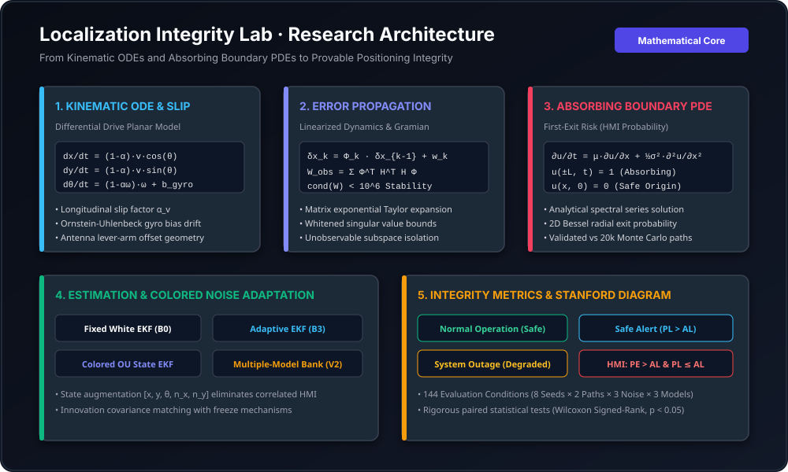
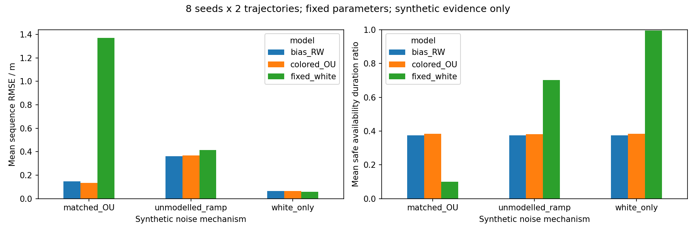

# Localization Integrity Lab · Mobile Robot Positioning Integrity

<div align="center">

[](LICENSE)
[](https://www.python.org/)
[]()
[](https://github.com/Daniel-24-life/AIfile)

**Reproducible Research Benchmark for Dynamic Localization Error Propagation, Absorbing Boundary PDEs, and Adaptive Integrity Filtering in Mobile Robotics**  
Kinematic ODE Modeling · Observability Gramian Bounds · Absorbing Boundary PDE (Kolmogorov First-Exit) · Colored-Noise Augmented EKF · Stanford Diagram Risk Accounting

[English](README.en.md) | [中文说明](README.md)

</div>

---

## 📌 Research Motivation & Problem Statement

In safety-critical navigation for autonomous mobile robots (AGVs, AMRs, automated guided carts):
> **How do unmodeled wheel slippage and degraded observations propagate into hazardous positioning errors? Why can a navigation filter operate inside unsafe operational boundaries without raising an alarm (Hazardously Misleading Information, HMI)?**

This repository provides an end-to-end mathematical and experimental benchmark bridging:
1. **Low-level physical kinematic ODEs** with longitudinal and rotational wheel slippage;
2. **Linearized error dynamics and observability Gramian analysis**;
3. **Absorbing boundary partial differential equations (PDEs)** governing first-exit failure probability;
4. **Colored-noise augmented Extended Kalman Filtering (EKF)** and Stanford diagram risk classification.

---

## 🏛️ System Research Architecture



The mathematical and experimental pipeline comprises five foundational pillars:
1. **Kinematic ODE & Slip Modeling**: Planar differential drive kinematics incorporating longitudinal slip $\alpha_v$, angular slip $\alpha_\omega$, Ornstein-Uhlenbeck (OU) gyroscope bias drift, and antenna lever-arm geometry $\mathbf{l}^b$.
2. **Error Dynamics & Observability Gramian**: Taylor series matrix exponential expansion of the continuous error transition matrix $\mathbf{F}(t)$, establishing whitened observability Gramian $\mathbf{W}_{\text{obs}}$ singular value bounds.
3. **Absorbing Boundary PDE for First-Exit Risk (HMI)**:
   $$\frac{\partial u}{\partial t} = \mu \frac{\partial u}{\partial x} + \frac{1}{2}\sigma^2 \frac{\partial^2 u}{\partial x^2}, \quad u(\pm L, t) = 1$$
   Derives analytical spectral series solutions for the probability of error boundary breach, validated against 20,000 Monte Carlo paths.
4. **Augmented State Estimators**: Compares Fixed White EKF (B0), Innovation Covariance Matching Adaptive EKF (B3), Colored-Noise Augmented EKF (Proposed), and Multiple-Model Hypothesis Testing Banks (Candidate Bank V2).
5. **Stanford Diagram Integrity Accounting**: Evaluates position error (PE), protection level (PL), and alert limit (AL) across Normal Operation, Safe Alert, System Outage, and HMI regimes.

---

## 📊 Key Experimental Findings & Trade-Offs

Across a factorial 144-condition synthetic benchmark (8 Random Seeds × 2 Trajectory Profiles × 3 Noise Regimes × 3 Filter Estimators), the experiments reveal a fundamental engineering trade-off:

| Noise Regime | Filter Estimator | ATE RMSE (m) | HMI Duration Ratio | Safe Availability Ratio | False Alarm Ratio |
| :--- | :--- | :--- | :--- | :--- | :--- |
| **Matched Correlated (OU Noise)** | Fixed White EKF (B0) | 1.371 m | **88.31%** (Severe Hazard) | 10.01% | 0.22% |
| **Matched Correlated (OU Noise)** | **Colored OU EKF (Proposed)** | **0.135 m** | **0.00% (HMI Eliminated)** | **38.31%** | 61.69% |
| **Pure White Gaussian Noise** | Fixed White EKF (B0) | **0.057 m** | 0.00% | **99.62%** | 0.38% |
| **Pure White Gaussian Noise** | Colored OU EKF (Proposed) | 0.065 m | 0.00% | 38.28% | 61.72% (Over-conservative) |

<div align="center">
  
  <p><em>Figure: Position error and availability trade-offs across correlated vs. white noise regimes</em></p>
</div>

> **Scientific Insight**: Filter state augmentation is not a silver bullet. While estimating colored noise states completely wipes out HMI under correlated disturbances, it penalizes system availability by ~61% when exposed to pure white noise. Dynamic hypothesis testing or multi-model switching is required in production.

---

## 🚀 Quick Start & 100% Deterministic Reproduction

The benchmark is self-contained with a deterministic trajectory generator—no external multi-gigabyte ROS bags required.

### 1. Installation
```bash
git clone https://github.com/Daniel-24-life/localization-integrity-lab.git
cd localization-integrity-lab
pip install -r requirements.txt
```

### 2. Reproduce the 144-Condition Benchmark
```bash
python scripts/run_synthetic_study.py
```
*Outputs: Generates full multi-seed trajectory metrics, terminal summary tables, and results CSV.*

### 3. Run Scientific Unit Tests
```bash
python -m pytest -c pytest.ini tests/ -v
```
*Outputs: 116 unit tests verifying physical ODE invariants, Gramian rank, and PDE spectral solutions pass in ~13 seconds.*

---

## 🛡️ Research Scope & Boundary Disclosures

In adherence to rigorous scientific ethics, this repository explicitly documents research boundaries (see [`docs/research_limitations.md`](docs/research_limitations.md)):
1. **Sample Unit Accounting**: The 144 evaluations represent combinations across 8 random seeds. These 8 seeds are repeated trial units and must not be cited as 144 independent physical field trials.
2. **Real-World Sequence Generalization (G4 Gate)**: In preliminary evaluations on real multi-sensor robot datasets under severe slippage, safe availability dropped to approximately 3.26% under strict 0.5 m limits; formal industrial certification remains an open research milestone.
3. **Protection Level Calibration**: Theoretical protection levels are derived from linearized Gaussian covariance bounds and have not undergone extreme-value tail fitting for safety-critical certifiable risk allocation ($P_{\text{HMI}} < 10^{-7}$).

---

## 🔗 Related Works & Ecosystem
- **Mathematical Formulations**: [`docs/mathematical_formulation.md`](docs/mathematical_formulation.md)
- **Portfolio Showcase (#14)**: [https://github.com/Daniel-24-life/AIfile](https://github.com/Daniel-24-life/AIfile)
- **Author Profile**: [Daniel-24-life](https://github.com/Daniel-24-life)
