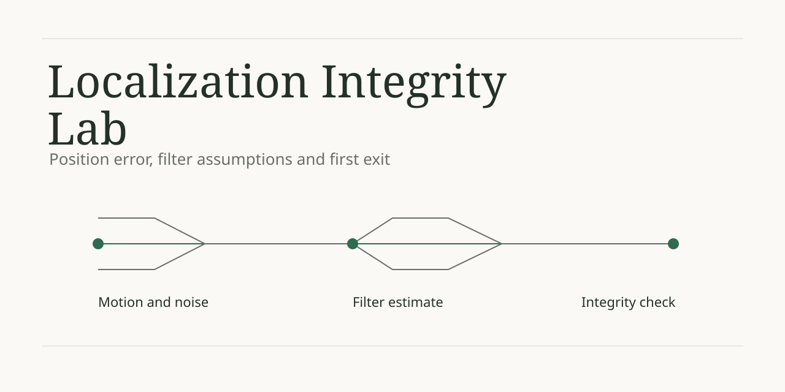

<picture>
  <source media="(prefers-color-scheme: dark)" srcset="docs/cover-dark.svg">
  <source media="(prefers-color-scheme: light)" srcset="docs/cover-light.svg">
  
</picture>

# Localization Integrity Lab

A research benchmark for studying positioning error, protection levels, and threshold crossings in synthetic mobile-robot experiments.

[中文说明](README.zh.md) · [Portfolio](https://github.com/Daniel-24-life/portfolio)


## What it demonstrates

- Integrate kinematic models and compare filter assumptions under prescribed noise.
- Use an absorbing-boundary PDE to investigate first exit for the specified stochastic model.
- Reproduce a synthetic benchmark and trace metrics to configuration and paired seeds.

**Stack** · Python, NumPy, SciPy, pandas, Matplotlib

## Repository layout

| Path | Contents |
| --- | --- |
| [`src/`](src/) | Models, filter, input validation and evaluation |
| [`scripts/`](scripts/) | Study and diagnostic entry points |
| [`configs/`](configs/) | Experiment configurations |
| [`results/`](results/) | Public aggregate results |
| [`tests/`](tests/) | Model and numerical checks |

## Run locally

```sh
python -m pip install -r requirements.txt
python scripts/run_synthetic_study.py
python -m pytest -c pytest.ini tests/ -q
```


## Scope and limits

The benchmark runs 144 conditions using eight synthetic seeds. Conditions share seeds and do not represent independent physical trials. Independent field generalization remains unverified, protection-level risk calibration remains open, and the real-data G4 gate did not pass. The theoretical first-exit probability applies to the specified stochastic model and is not a measured robot HMI rate.

[Mathematical formulation](docs/mathematical_formulation.md) · [Research limits](docs/research_limitations.md) · [Benchmark configuration](configs/default_config.yaml) · [Benchmark notes](docs/benchmark-notes.md)
