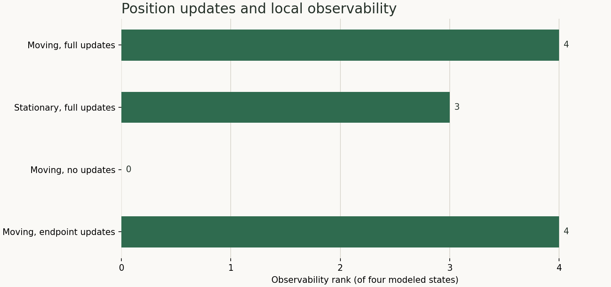
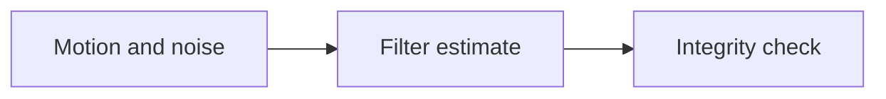

<picture>
  <source media="(prefers-color-scheme: dark)" srcset="docs/cover-dark.svg" />
  <source media="(prefers-color-scheme: light)" srcset="docs/cover-light.svg" />
  
</picture>

# Localization Integrity Lab

Compare positioning error, filter assumptions, and first-exit behavior under specified robot motion and noise models.

[▶ Demo](#demo) · [中文](README.zh.md) · [](https://github.com/Daniel-24-life/localization-integrity-lab/actions/workflows/ci.yml) · [MIT](LICENSE) · Python 3.10+

## Demo



The figure reports four scenarios from the public frozen-linear observability audit below.

## Problem

A position estimate and its uncertainty respond differently to changes in motion and process noise. The benchmark holds the design fixed so those differences can be examined.

## What I built

- Integrate motion models and compare filter assumptions.
- Estimate first-exit behavior with an absorbing-boundary model.
- Reuse paired seeds to compare treatments under the same conditions.
- Trace measurements to experiment configuration and source code.

## How it works



## Run in 60 seconds

```sh
python -m pip install -r requirements.txt
python scripts/run_linear_research_audit.py
```

The command writes all four observability scenarios to a local audit.json.

## Tests

**116 tests passed.** [Verified GitHub Actions run](https://github.com/Daniel-24-life/localization-integrity-lab/actions/runs/45105812003).

```sh
python -m pytest -c pytest.ini tests/ -q
```

## Repository layout

| Path | Contents |
| --- | --- |
| [`src/`](src/) | Models, filters and evaluation |
| [`scripts/`](scripts/) | Study entry points |
| [`configs/`](configs/) | Experiment configuration |
| [`results/`](results/) | Public aggregate results |

Reference material · [mathematical_formulation.md](docs/mathematical_formulation.md) · [summary.csv](results/summary.csv)

<sub>The benchmark reuses eight synthetic seeds across 144 settings. Independent field generalization and protection-level calibration remain open. First exit applies to the specified stochastic model.</sub>
