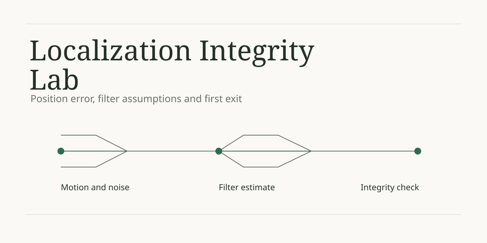
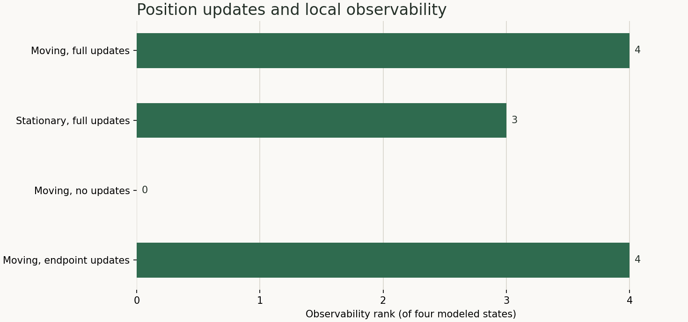

<picture>
  <source media="(prefers-color-scheme: dark)" srcset="docs/cover-dark.svg" />
  <source media="(prefers-color-scheme: light)" srcset="docs/cover-light.svg" />
  
</picture>

# 移动机器人定位完整性研究

在给定运动模型和噪声条件下，比较定位误差、滤波假设与首次越界。

[查看演示](#demo) · [English](README.md) · [](https://github.com/Daniel-24-life/localization-integrity-lab/actions/workflows/ci.yml) · [MIT](LICENSE) · Python 3.10+

## Demo



图表展示下方公开线性可观测性审计的四种观测情景。

## 要解决的问题

改变运动和噪声模型会改变定位误差及不确定性。固定设计与种子有助于比较变化来自哪里。

## 实现

- 积分运动模型并比较不同滤波配置。
- 用吸收边界模型估计首次越界。
- 保留配对种子及配置以便复核。

## 工作流程


## 快速运行

```sh
python -m pip install -r requirements.txt
python scripts/run_linear_research_audit.py
```

命令把四种观测情景的结果写进本地 audit.json。

## 测试

实测 **116 项通过**。[通过的 GitHub Actions 运行](https://github.com/Daniel-24-life/localization-integrity-lab/actions/runs/45105812003)。

```sh
python -m pytest -c pytest.ini tests/ -q
```

## 仓库目录

| 路径 | 内容 |
| --- | --- |
| [`src/`](src/) | Models, filters and evaluation |
| [`scripts/`](scripts/) | Study entry points |
| [`configs/`](configs/) | Experiment configuration |
| [`results/`](results/) | Public aggregate results |

延伸阅读 · [mathematical_formulation.md](docs/mathematical_formulation.md) · [summary.csv](results/summary.csv)

<sub>图中数据来自公开线性可观测性审计。完整性基准以 8 组合成种子配对比较 144 个设置，现场泛化和保护水平校准待验证。</sub>
